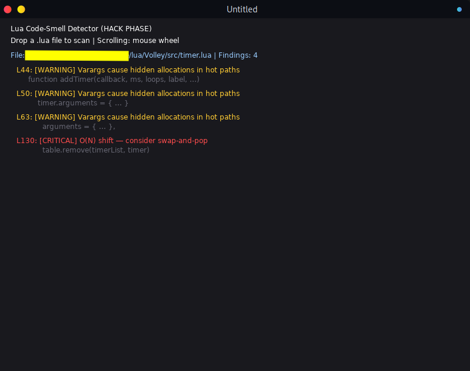

# moondog

Lua code-smell detector and anti-pattern indicator.


moondog is a static analysis tool for Lua source files. Instead of focusing on syntax or style, it flags code patterns with a measurable runtime cost: hidden allocations, O(N^2) table operations, and iterator overhead in hot loops.

## Demo



moondog v0.1 running under LÖVE 11.5, scanning a real-world Lua file and reporting findings with line numbers, severity, and the offending source line.

## What it detects

| Pattern | Severity | Why it matters |
|---|---|---|
| `string.format` and `..` concatenation | info | Allocates a new string on every call; avoid inside hot loops |
| `table.insert` | warning | `t[#t + 1] = v` is faster for appends |
| `table.remove` | critical | O(N) element shift; causes cache thrashing when used in loops |
| `pairs()` / `ipairs()` | warning | Iterator and hash-lookup overhead; prefer numeric `for` in hot paths |
| `...` (varargs) | warning | Hidden table allocation per call |
| `setmetatable` | info | Metatable indirection; verify it is not on a hot path |
| `collectgarbage` | warning | Manual GC calls usually mask an allocation problem |

Severity levels:

- `critical` - likely performance explosion at scale
- `warning` - measurable cost; review before using in hot paths
- `info` - code smell worth a second look

## Quick start

### Prerequisites

- LÖVE 11.5 or newer
- Bash (for the build script)

### Build

```bash
git clone https://github.com/Vit0rg/moondog.git
cd moondog
./scripts/build/build.sh --target=love
```

The build system concatenates every source file listed in `scripts/manifests/love_manifest.txt` into a single `build/love/main.lua`.

### Run

```bash
love build/love/
```

Then drop any `.lua` file onto the window. Findings appear with line number, severity, and source excerpt. Scroll with the mouse wheel.

## How it works

1. `scanner.lua` reads the target file line by line.
2. Each line is matched against the pattern table in `rules.lua` using Lua's native string matching. No external parser is required.
3. `renderer.lua` and `ui.lua` draw the findings inside the LÖVE window.
4. `sentinel.lua` is a small development-time profiler (GC delta and timing) used to keep moondog itself fast. It is not part of the scan output.

## Development philosophy

moondog follows a measure-before-optimizing workflow:

1. Ship a simple, working implementation first.
2. Profile it against large inputs (10k+ line files) and watch allocations.
3. Optimize only the paths where measurements prove it is needed.

The same idea drives the detections themselves: a pattern is only flagged when it has a measurable runtime cost, not because it looks unusual.

## Project layout

```text
.
├── build/                  # generated output (gitignored)
│   ├── cli/
│   └── love/
│       └── main.lua        # concatenated LÖVE build
├── docs/                   # screenshots and documentation
│   └── demo_v0.1.png
├── scripts/
│   ├── build/
│   │   └── build.sh        # manifest-driven build pipeline
│   └── manifests/
│       └── love_manifest.txt
├── src/
│   ├── main.lua            # LÖVE callbacks, app entry
│   ├── renderer.lua        # results rendering
│   ├── rules.lua           # smell patterns and severities
│   ├── scanner.lua         # line-by-line pattern matcher
│   ├── sentinel.lua        # dev-time GC/timing profiler
│   └── ui.lua              # window chrome and input
├── project_tree.md
└── README.md
```

## Versioning

### v0.1 (current)

- Line-based pattern scanner with the built-in rule set
- LÖVE GUI with drag-and-drop scanning and wheel scrolling
- Severity coloring (critical / warning / info)
- Manifest-driven bash build pipeline
- Bundled sentinel profiler for self-measurement

## Roadmap

- File browser inside the app (open dialog, folder scanning)
- Save button: export findings to JSON or text for CI-friendly output
- Larger rule set, grouped by category (memory, algorithmic, style)
- UI improvements (syntax highlighting, collapsible findings, progress indicator)
- CLI target manifest so the scanner can run headless
- Cross-file analysis (global variable pollution)

## Contributing

1. Fork the repository
2. Create a feature branch
3. Commit your changes
4. Push and open a pull request

When adding rules, include a short justification of the runtime cost in the `msg` field, and test the scanner against a large file before submitting.

## License

MIT

## Acknowledgments

- LÖVE - the framework that powers the GUI
- Lua - the language being analyzed
- luacheck and the Lua tooling community - inspiration for static analysis in pure Lua